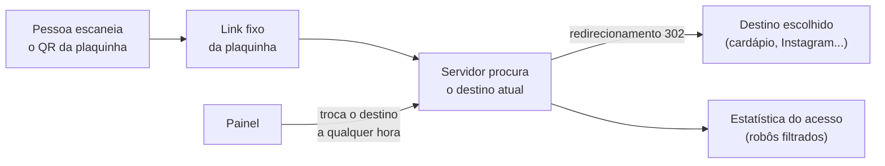

# QR Code Manager

**QR codes dinâmicos para plaquinhas de balcão, mesa e vitrine: o QR impresso nunca muda, e o destino pode ser trocado a qualquer momento pelo painel.**

Cada plaquinha recebe um link fixo, gravado no QR code (e, se quiser, num chip NFC). Quem escaneia é redirecionado para o destino configurado no painel — cardápio, Instagram, avaliação no Google — sem reimprimir nada.

> Este repositório é só a **apresentação** do projeto. O código é privado (veja o fim da página).

---

## Como funciona

---

## O que faz

- **Plaquinhas:** links com identificador aleatório ou personalizado, troca de destino com histórico. Trocar o identificador de uma plaquinha já impressa mantém o antigo como apelido que continua funcionando.
- **Lotes:** gera várias plaquinhas de uma vez e baixa todos os QR codes num ZIP; depois cada uma é vinculada a um cliente e a um destino.
- **Clientes:** cadastro simples com as plaquinhas de cada um.
- **Estatísticas:** acessos por dia, celular × computador, com filtro de robôs.
- **Painel administrativo** com login por usuário e aviso quando o endereço base ainda é provisório, para não imprimir QR com endereço errado.

---

## Decisões técnicas

- **Redirecionamento 302 sem cache:** um 301 ficaria preso no cache dos leitores de QR e impediria trocar o destino.
- **Identificadores permanentes:** o banco garante que um identificador nunca volta a ser usado, para uma plaquinha impressa nunca apontar para o cliente errado.
- **Autenticação própria:** senha com scrypt e sessão em JWT num cookie HttpOnly; a sessão é conferida no banco a cada ação, o que permite revogá-la. Limite de tentativas de login.
- **Banco protegido:** acesso só pelo servidor, tabelas com RLS e sem permissões para papéis públicos.
- **Migrações com verificação:** uma migração alterada depois de aplicada é recusada.
- **Ambiente com um comando:** um script sobe banco e aplicação no Windows, gerando os segredos locais sozinho.

Comecei com Supabase e depois migrei para um PostgreSQL simples em Docker com autenticação própria, para ter menos peças e controle total das regras.

---

## Sobre o código

O código é **privado**. Mostro a arquitetura e trechos em entrevista.

Contato: [LinkedIn](https://www.linkedin.com/in/neemiasjls/)
